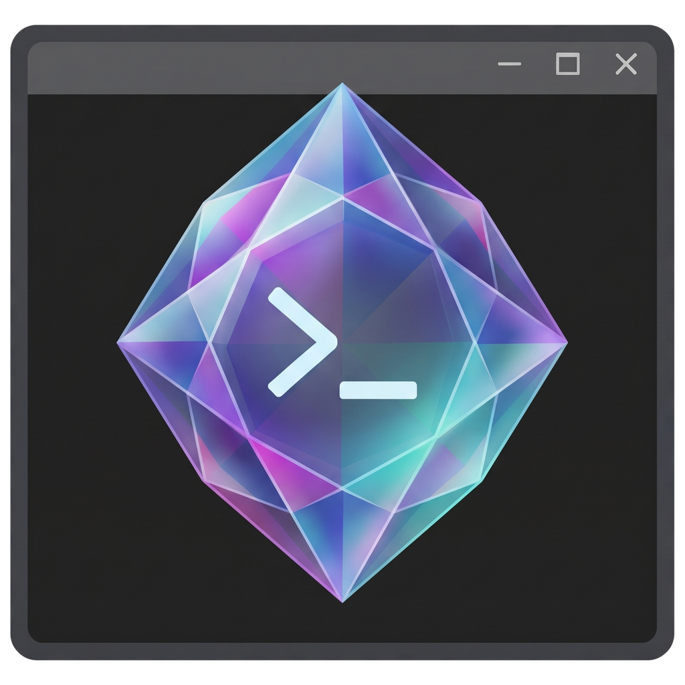
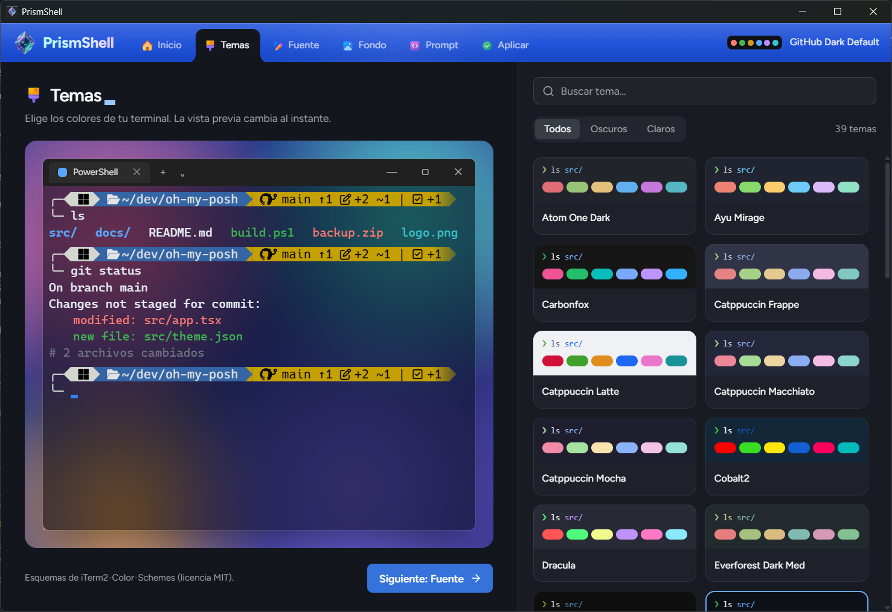
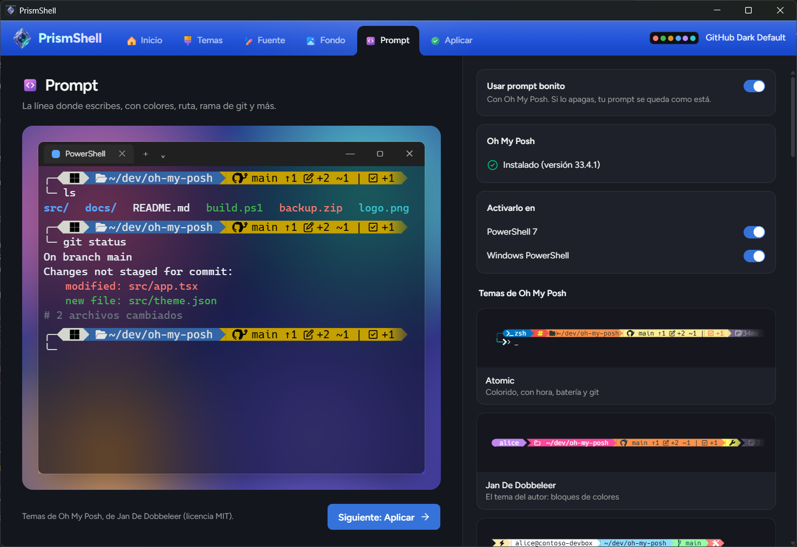
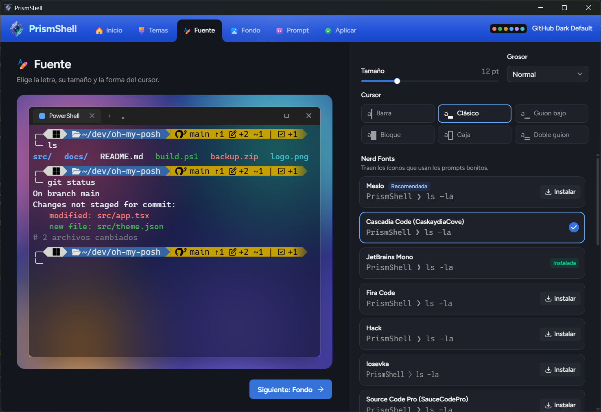
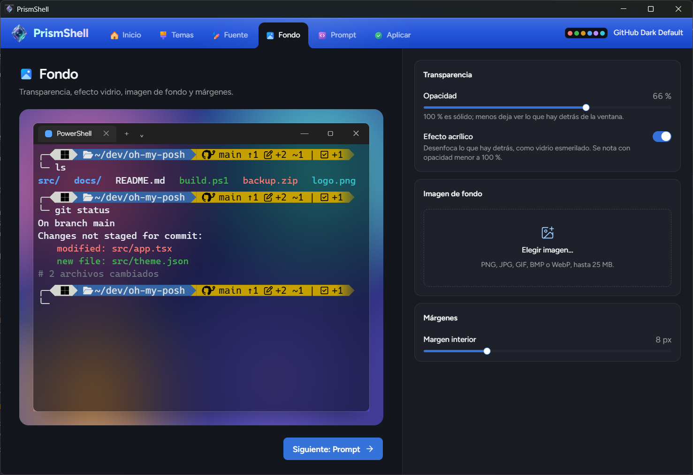
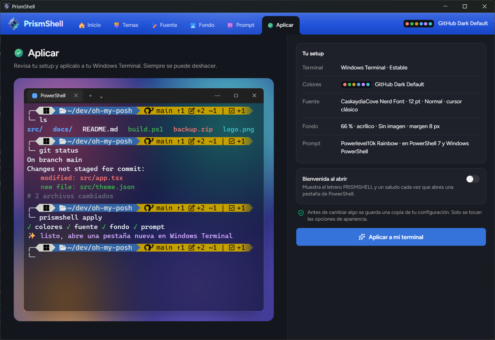

<div align="center">



# PrismShell

**Haz que tu Windows Terminal se vea increíble, sin tocar una sola línea de JSON.**

Colores, fuentes, transparencia y un prompt con estilo, con vista previa en vivo.
Lo aplicas con un clic y siempre lo puedes deshacer.




</div>

## Por qué

Ves un setup de terminal precioso en internet y quieres el tuyo igual, pero terminas editando `settings.json` a mano, buscando fuentes con iconos y copiando comandos que no entiendes. PrismShell hace todo eso por ti: eliges lo que te gusta, lo ves al instante y lo aplicas a tu Windows Terminal real.

No es una terminal nueva. Configura la que ya tienes.

## Qué puedes personalizar

| | |
|---|---|
| **Colores** | 39 esquemas populares: Catppuccin, Dracula, Nord, Tokyo Night, Gruvbox, Rosé Pine, Kanagawa, Everforest y más. |
| **Fuente** | Nerd Fonts seleccionadas (Meslo, Cascadia, JetBrains Mono, Fira Code…). Se instalan desde la app, sin permisos de administrador. |
| **Fondo** | Opacidad, efecto acrílico, imagen de fondo y márgenes. |
| **Cursor** | Barra, bloque, caja, guion bajo, doble guion o clásico. |
| **Prompt** | Más de 20 temas de [Oh My Posh](https://ohmyposh.dev), con la ruta, la rama de git y más. Oh My Posh también se instala desde la app. |
| **Bienvenida** | Un letrero PRISMSHELL con degradado cada vez que abres PowerShell. Opcional. |

## Capturas

<table>
  <tr>
    <td width="50%"><br /><sub><b>Prompt</b>: temas de Oh My Posh con vista previa.</sub></td>
    <td width="50%"><br /><sub><b>Fuente</b>: Nerd Fonts, tamaño, grosor y cursor.</sub></td>
  </tr>
  <tr>
    <td width="50%"><br /><sub><b>Fondo</b>: opacidad, acrílico, imagen y márgenes.</sub></td>
    <td width="50%"><br /><sub><b>Aplicar</b>: resumen de tu setup y un solo botón.</sub></td>
  </tr>
</table>

## Tu configuración está a salvo

- Antes del primer cambio se guarda una copia de tu `settings.json`.
- Solo se tocan las opciones de apariencia. Tus comentarios, perfiles y atajos se quedan igual.
- Los esquemas de color van en un archivo aparte (un *fragment* de Windows Terminal), no dentro de tu configuración.
- En tu perfil de PowerShell solo se escribe dentro de un bloque marcado, y nada fuera de él.
- **Deshacer** quita únicamente lo que puso PrismShell. **Restaurar todo** deja tu terminal exactamente como estaba.
- Nunca pide permisos de administrador.

## Requisitos

Windows 11. Ya incluye todo lo necesario: Windows Terminal, winget y Windows PowerShell. PowerShell 7 es opcional; si lo tienes, el prompt también se activa ahí.

## Desarrollo

Necesitas Node 20+, pnpm, Rust (rustup) y Microsoft C++ Build Tools.

```bash
pnpm install
pnpm tauri dev     # correr la app
pnpm test          # pruebas
pnpm lint          # revisión de tipos
pnpm tauri build   # generar el instalador
```

Hecho con Tauri 2, React 19, TypeScript, Tailwind CSS v4, shadcn/ui y Zustand.

## Créditos

- Esquemas de color: [iTerm2-Color-Schemes](https://github.com/mbadolato/iTerm2-Color-Schemes) (MIT).
- Temas de prompt: [Oh My Posh](https://github.com/JanDeDobbeleer/oh-my-posh), de Jan De Dobbeleer (MIT).
- Fuentes: [Nerd Fonts](https://www.nerdfonts.com) y sus fuentes originales. Cada licencia está junto a sus archivos en `src/assets`.

## Licencia

[MIT](LICENSE) © 2026 German Sansores
